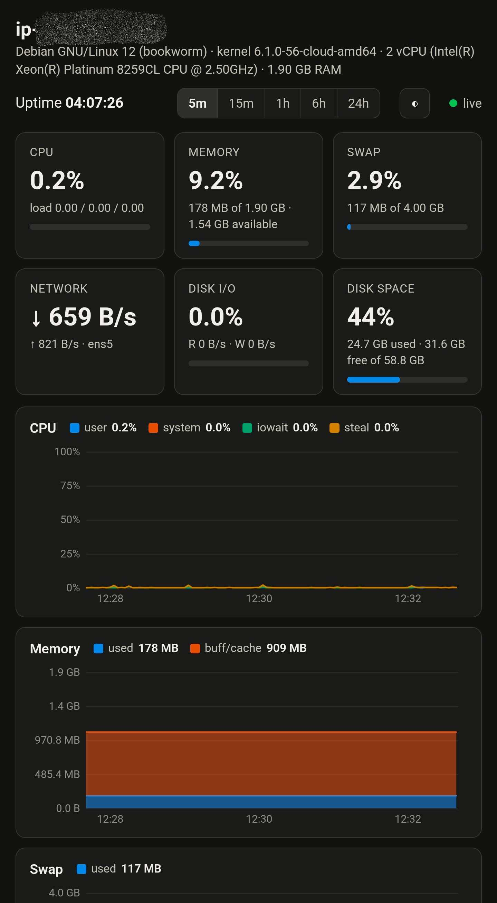
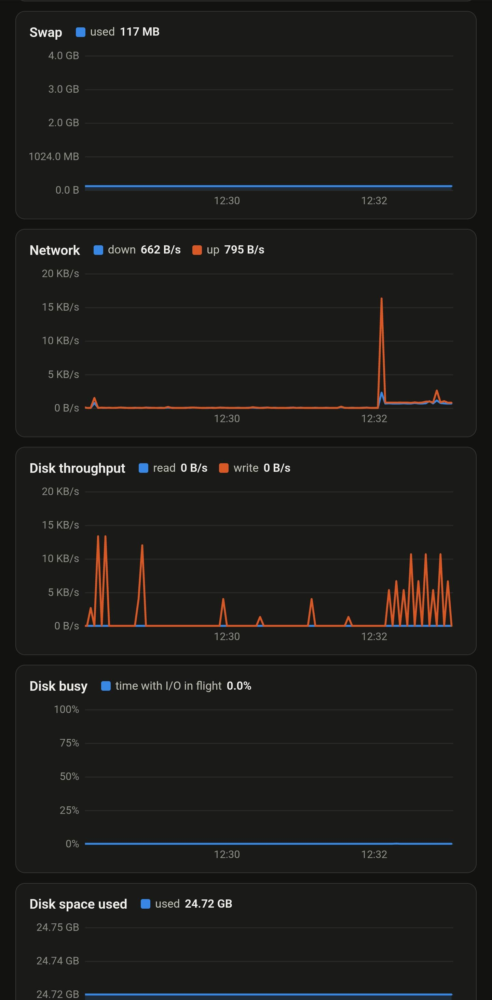
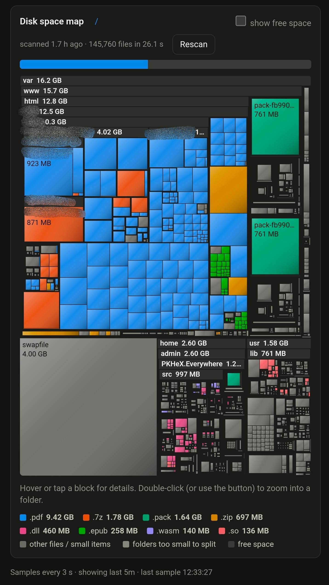

# sysdash

A live dashboard for one Linux server: CPU, memory, swap, network, disk I/O, disk space,
and uptime, with 24-hour history, in 3-second intervals (both adjustable). It also has a WinDirStat-style map of disk usage.

- **Backend:** `sysdash.py`. It needs only Python 3.8 or newer, with no pip packages. It reads `/proc`
  and listens on 127.0.0.1:8765, so the internet can't reach it directly.
- **Frontend:** `www/index.html`. It's a single page with no CDN and no libraries.
- **Apache:** serves it at `/dashboard/` behind a username and password.

## Screenshots

<p align="center">
  
  

</p>

## Install

```bash
scp -r sysdash/ ubuntu@your-server:~
ssh ubuntu@your-server
cd sysdash && sudo ./install.sh
```

Then open `https://<your-domain>/dashboard/`. Use HTTPS, because Basic auth sends the
password with every request. The conf is global, so `/dashboard/` works on every site
Apache serves. To limit it to one site, delete it from conf-enabled
(`sudo a2disconf sysdash`) and paste the `<Location>` block into that site's vhost.

## What the numbers mean

| Panel | Source |
|---|---|
| CPU | `/proc/stat`. "steal" is time the hypervisor took back. On a Lightsail burstable instance, steal climbing means you've run out of CPU burst credits. |
| Memory | Same definitions as `free`. Used + buff/cache + free = total. |
| Network | The interface with the default route (usually `eth0` / `ens5`). |
| Disk throughput / busy | `/proc/diskstats`. Busy is the share of time the disk had I/O in flight. |
| Disk space map | Allocated size of every file on `/`, scanned in the background every 6 h or when you press **Rescan**. Items under ~1/12000 of used space are grouped into "N smaller items" blocks to keep the page light. Hard links are counted once. Other mounted filesystems are skipped. |

History is kept for 24 hours. Ranges of 1 hour or more are averaged into buckets, so
short spikes are smoothed. Use 5m or 15m to see every 3-second sample. History is
saved to `/var/lib/sysdash` and survives restarts.

## Options

Edit `ExecStart` in `/etc/systemd/system/sysdash.service`, then run
`sudo systemctl daemon-reload && sudo systemctl restart sysdash`:

- `--retention-hours 24`: how much history to keep. RAM cost is about 0.5 MB per hour.
- `--scan-every-hours 6`: how often to rescan automatically. `0` means only when you press Rescan.
- `--scan-nodes 12000`: treemap detail.
- `--root /`: which filesystem to measure and map.

## Handy commands

```bash
systemctl status sysdash
journalctl -u sysdash -f
sudo htpasswd -B /etc/apache2/sysdash.htpasswd anotheruser   # add or change a login
```

## Uninstall

```bash
sudo a2disconf sysdash && sudo systemctl reload apache2
sudo systemctl disable --now sysdash
sudo rm -rf /opt/sysdash /var/lib/sysdash /etc/systemd/system/sysdash.service \
            /etc/apache2/conf-available/sysdash.conf /etc/apache2/sysdash.htpasswd
sudo userdel sysdash
```

## License

MIT - see [LICENSE](LICENSE).
